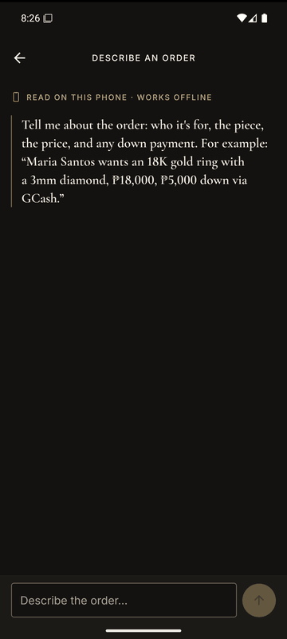
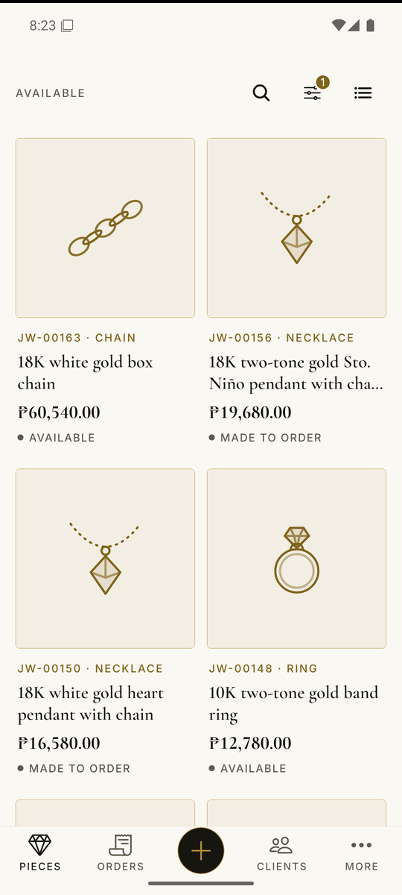
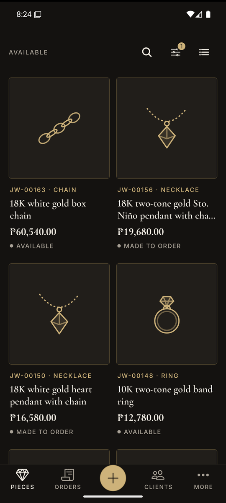
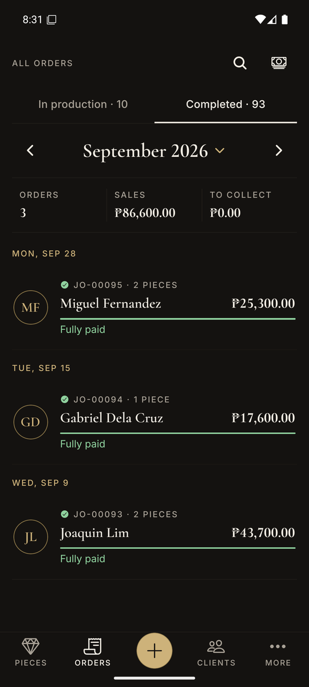
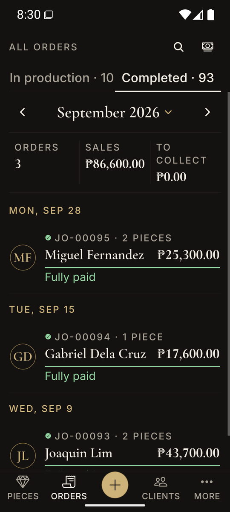

# Hiyas — jewelry business records

[](https://github.com/arfmagno/jewelry-mgt-mobile-app/actions/workflows/ci.yml)
[](https://github.com/arfmagno/jewelry-mgt-mobile-app/actions/workflows/e2e.yml)

*Hiyas* is Tagalog for "jewel". It's an offline-first Android app for running a small jewelry business: pieces (with their parts, stones, costs and photos), clients, job orders with down payments, suppliers, material purchases and stock, plus AI-generated design images from a text description.

It runs entirely on always-free cloud tiers and works without a connection. The phone's database is the source of truth, and changes sync in the background when the phone is online.

<p align="center">
  
</p>

<table>
  <tr>
    <td></td>
    <td></td>
    <td></td>
    <td></td>
  </tr>
  <tr>
    <td align="center">Ivory</td>
    <td align="center">Noir</td>
    <td align="center">Orders by month</td>
    <td align="center">150% text</td>
  </tr>
</table>

| | |
|---|---|
| **App** | React Native (Expo SDK 58, Expo Router), TypeScript, SQLite on device |
| **API** | AWS Lambda (Node 24, arm64) behind a Function URL; JWTs verified in code |
| **Data** | DynamoDB single table (provisioned 5/5 + 5/5 GSI, inside the always-free tier) |
| **Auth** | Amazon Cognito (Lite tier) |
| **Photos** | Cloudflare R2 via presigned URLs (10 GB free, no egress fees) |
| **AI** | Cloudflare Workers AI: FLUX.1 schnell design images, Llama 3.1 8B prompt enhancement, Llama 3.3 70B reading order messages (with an on-device fallback) |
| **Infra / CI** | AWS CDK, GitHub Actions with OIDC (no stored AWS keys) |

## Features

- **Describe an order**: type (or dictate) an order the way a client would message it, such as *"Bea Ramos wants an 18K white gold ring with a 3mm diamond, ₱18,000, 5k down via GCash"*. The assistant finds the client, offers matching pieces in stock, asks only for what's missing and shows the order to confirm. Online it reads the message with an LLM; offline, a rule-based reader on the phone does the same job.
- **Pieces**: rings, earrings, pendants, chains, bracelets, and sets made of several parts. Each part has its own measurements, metal (or one metal for the whole piece), and the stones set on it. Pieces are either on-hand stock or made to order.
- **Costs**: metal by weight (with the latest supplier price filled in), labor, plating/*tubog*, engraving and other costs, plus a price on each stone. The app suggests a selling price from cost and a default markup.
- **Job orders**: a client, one or more pieces, manual status (in production / completed), down payments and balance, and profit per order. Completed orders are browsed a month or a year at a time, with totals for each.
- **Receipts**: a one-page PDF receipt for any order, shared straight to Messenger, Viber or email. Costs and profit never appear on it.
- **Payment reminders**: pick a day to be reminded about a balance; the notification opens the order.
- **Clients**: grouped by surname, with how many orders each has and what they still owe.
- **Photos & AI designs**: photos are compressed on the device (WebP, ≤1600 px) and uploaded when online. You can generate design drafts from a description, keep the ones you like and discard the rest.
- **Suppliers, purchases and materials**: purchase history gives the latest price per material. Optional stock tracking counts purchases, adjustments, and usage in pieces.
- **Trash**: deletes are reversible for 7 days. After that a record is removed, or archived if order history still refers to it.
- **Reports**: monthly sales, cost, profit and collections.
- **Settings**: light, dark or system appearance, inches or centimetres, US or ISO ring sizes, default markup, stock tracking, and sample data to explore the app.

## Repository layout

```
packages/shared   Domain model: zod schemas for every table, option lists, money/units/phone helpers, API contract
packages/core     Offline engine: SQLite store, outbox, lifecycle rules (trash/restore/purge), queries, sync engine
backend           Lambda handler: sync push/pull, photo upload URLs, AI design generation, reading order messages
infra             CDK stacks: app stack + GitHub OIDC deploy role, with free-tier guardrail tests
mobile            Expo Router app (screens in mobile/src/app)
docs              Architecture, data model, sync protocol, design system, deployment
```

## Getting started

Requires Node 24 (`nvm use`).

```sh
npm install
npm test                  # unit tests (shared, core, backend, infra, mobile)
npm run test:integration  # sync through the real handler against a local DynamoDB emulator
npm run typecheck
```

Run the app in **offline-only mode** (no backend needed):

```sh
cd mobile
npx expo run:android      # builds a development build onto a device or emulator
```

To connect it to a deployed backend, copy `mobile/.env.example` to `mobile/.env.local` and fill in the stack outputs. See [docs/deployment.md](docs/deployment.md).

## Testing

| Level | Tooling | Covers |
|---|---|---|
| Unit | Vitest, Jest + React Native Testing Library | domain rules, units and money, phone parsing, reading order messages and the order assistant's conversation, receipts, store and lifecycle, sync engine, API handlers, form models, accessibility semantics of UI primitives |
| Integration | Vitest + dynalite | two devices syncing through the real Lambda handler and DynamoDB table layout |
| Infrastructure | CDK assertions | free-tier capacity limits, no paid-by-default services, retention, OIDC trust scope |
| End-to-end | Maestro on an Android emulator | create a client, sell a piece with a down payment and the balance, delete and restore from Trash, describe an order in one message |

## Documentation

- [Architecture](docs/architecture.md)
- [Data model](docs/data-model.md)
- [Offline sync](docs/sync.md)
- [Design system & accessibility](docs/design-system.md)
- [Deployment](docs/deployment.md)
